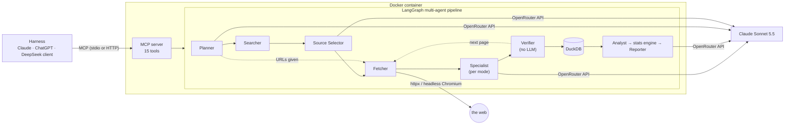

# scraper-mcp

An **MCP server in a Docker container** that scrapes the web with a **team of LLM agents** and answers
with **reproducible statistics**. Plug it into any MCP-capable harness (Claude Desktop, Claude Code,
ChatGPT, or a client running DeepSeek or another model) and ask things like:

> *"What does a 1-bedroom flat rent for in Dubai Marina, and does furnishing change the price?"*
> *"Scrape these three job boards and tell me which skills pay the most."*

The harness's own LLM never reads raw HTML. It calls a tool; inside the container a LangGraph pipeline
plans, searches, scrapes, extracts, verifies and analyses, and the harness gets back clean data, numbers,
and a chart.

**Design rule: the LLM turns messy web pages into structured records; every number comes from
pandas / scipy.** An LLM does not calculate a mean, a p-value or a correlation in this system. The
Analyst agent only *chooses* operations from a fixed menu, and the Reporter's prose is audited
automatically: any number in it that the statistics engine did not produce is flagged.

---

## Architecture



| Agent | LLM? | Job |
|---|---|---|
| **Planner** | yes | Picks the specialist mode, writes 1-3 search queries aimed at *listing* pages, sets the analysis question |
| **Searcher** | no | DuckDuckGo search (`ddgs`), de-duplicated, social media filtered out |
| **Source Selector** | yes (fast model) | Ranks the results most likely to hold many comparable records, across domains, with backups that replace any site that refuses |
| **Fetcher** | no | robots.txt, per-domain rate limit, static HTTP first, headless Chromium only if the page needs JavaScript |
| **Schema Designer** | yes | Generic mode without fields: proposes the record schema from the page |
| **Specialists** | yes | One per mode (e-commerce, jobs, news, real estate, reviews, research papers, generic). Turns page text and schema.org JSON-LD into typed records |
| **Verifier** | no | Cleans types, drops empty and duplicate records (per-mode identity, so a job reposted under a new ID counts once), computes a **grounding score** per record: the share of copied values found on the page, understanding `£56.50`, `1,299` and `$150k` |
| **Analyst** | yes | Reads the dataset profile and picks operations from the statistics menu (never computes) |
| **Stats engine** | no | pandas / numpy / scipy execute the plan |
| **Reporter** | yes (fast model) | Writes the findings from the computed results; every number in it is audited |

The **Verifier** and **number audit** are the anti-hallucination layer. In the test suite the fake LLM
deliberately invents a product; it gets grounding 0.0, is excluded from the analysis, and a made-up
number in the report is listed in `unverified_numbers`.

---

## Quick start

**1. Configure.**

```bash
cp .env.example .env
```

Open `.env` and set at least `OPENROUTER_API_KEY` (https://openrouter.ai/keys) and `SCRAPER_CONTACT`
(your repo URL or e-mail; some sites, Wikipedia for one, refuse bots that do not say who they are).

**2. Build the image** (about 2 GB: Python data stack plus headless Chromium).

```bash
docker build -t scraper-mcp:latest .
```

**3. Connect a harness**, either stdio (the harness starts a container per session) or HTTP (one
long-running container). Both read and write the same `./data` folder.

### Claude Code

Run from the project folder (stdio):

```bash
claude mcp add scraper -- docker run -i --rm --init --env-file "$(pwd)/.env" -v "$(pwd)/data:/data" scraper-mcp:latest
```

Or start the HTTP server and point Claude Code at it:

```bash
docker compose up -d --build
```

```bash
claude mcp add --transport http scraper http://localhost:8000/mcp
```

(If you set `MCP_AUTH_TOKEN`, add `--header "Authorization: Bearer <token>"`.)

### Claude Desktop

Copy [configs/claude_desktop_config.json](configs/claude_desktop_config.json) into Claude Desktop's
config (Settings → Developer → Edit Config), replace `/ABSOLUTE/PATH/TO/project` with this folder's
absolute path, and restart Claude Desktop.

### ChatGPT

ChatGPT connects to **remote** MCP servers, so it needs a public HTTPS URL:

1. In `.env`, set `MCP_AUTH_TOKEN` if your connector settings let you add an `Authorization` header.
   If they do not, set `MCP_PATH` to a long random path instead (for example `/mcp-8f3c2a91d0e4`), which
   then acts as the secret.
2. `docker compose up -d --build`
3. Expose port 8000 with a tunnel (for example `cloudflared tunnel --url http://localhost:8000`) and add
   the tunnel's host name to `MCP_ALLOWED_HOSTS` in `.env`, then `docker compose up -d` again.
4. In ChatGPT, enable developer mode and add a connector with the URL `https://<tunnel-host><MCP_PATH>`.

Connector menus change often; check OpenAI's current docs for where the setting lives in your plan.

### DeepSeek and other models

DeepSeek's own chat app has no MCP client. Use an MCP-capable client (for example Cherry Studio,
LibreChat, Cline or Continue), choose DeepSeek as the model, and add this server with the same `docker run`
command (stdio) or the `http://localhost:8000/mcp` URL (HTTP).

### Debugging with MCP Inspector

```bash
npx @modelcontextprotocol/inspector
```

Then connect to `http://localhost:8000/mcp` (Streamable HTTP), or choose stdio with the `docker run` command.

---

## Tools

| Tool | LLM? | What it does |
|---|---|---|
| `research(query, mode="auto", max_sources=5, …)` | yes | The whole pipeline: plan → search → select → scrape → verify → store → analyse |
| `scrape(urls, mode, fields?, instructions?, …)` | yes | Pipeline on URLs you already know; follows pagination with `max_pages_per_source` |
| `analyze(dataset, question)` | yes | Analyst picks statistics, the engine computes them, Reporter writes audited findings (+ chart) |
| `search_web(query)` | no | Search results only |
| `fetch_page(url)` | no | One page as clean Markdown + JSON-LD + next-page link |
| `scrape_tables(url)` | no | Classic scraping: HTML `<table>` → dataset with `pandas.read_html`, numbers and dates parsed |
| `list_datasets()` / `describe_dataset(dataset)` | no | Inventory and profile (types, missing values, ranges, top values, grounding) |
| `run_stat(dataset, operation, filters?)` | no | One statistical operation (menu below) |
| `query_sql(sql)` | no | Read-only DuckDB SQL over the datasets, in a sandbox |
| `chart(dataset, kind, x, y?, …)` | no | bar · hist · line · scatter (with trend + r) · box, returned as PNG |
| `export_dataset(dataset, format)` | no | CSV / JSON / Parquet into `./data/exports`, optionally returned inline |
| `scrape_stats()` | no | Statistics about the scraper itself: success rate, static vs browser, robots blocks, latency, domains, tokens, cost |
| `list_modes()` / `delete_dataset(dataset, confirm)` | no | Housekeeping |

### Modes (specialists)

| Mode | Fields (highlights) | Derived by pandas |
|---|---|---|
| `ecommerce` | name, brand, price, original_price, currency, rating, review_count, in_stock | `discount_pct` |
| `jobs` | title, company, location, remote, seniority, salary_min/max/currency/period, skills | `salary_mid_annual` |
| `news` | headline, source, author, published_date, sentiment, topics, entities | |
| `real_estate` | listing_type, property_type, price, price_period, bedrooms, area_sqm, location | `price_per_sqm` |
| `reviews` | subject, rating, text, sentiment, aspects, review_date | |
| `research_papers` | title, authors, year, venue, citations, fields_of_study | |
| `generic` | anything: `fields=["name", "price:float", "tags:list"]`, or the Schema Designer proposes them | |

### Statistics menu

`describe` · `value_counts` (explodes list columns such as skills) · `groupby` · `correlation`
(Pearson/Spearman with p-values) · `compare_groups` (Welch t-test, Mann-Whitney U, Cohen's d; ANOVA and
Kruskal-Wallis for 3+ groups) · `outliers` (IQR or z-score) · `time_series` (D/W/M/Q/Y) · `crosstab`
(with chi-square) · `top_n` · `histogram` · `regression` (OLS with standard errors, p-values, R²).

---

## Try it (a demo script for the presentation)

These sandbox sites exist for scraping practice, so they are safe to hit in class:

1. *"Use scrape_tables on https://www.scrapethissite.com/pages/forms/?per_page=100 and save it as hockey. Then
   regress wins on goals for and goals against."* No LLM inside: R² ≈ 0.87 on 100 teams.
2. *"Fetch https://quotes.toscrape.com/js/ and tell me how it was fetched."* The page is empty without
   JavaScript, so the server switches to headless Chromium (`js_fallback: true`).
3. *"Scrape https://books.toscrape.com/catalogue/category/books/mystery_3/index.html in ecommerce mode,
   follow 2 pages, and analyse prices by rating."* Specialist extraction plus pagination and analysis.
4. *"Research remote data-analyst salaries in Europe."* Full pipeline from a plain question.
5. *"Show scrape_stats."* Success rates, static vs browser, robots blocks, tokens and cost.

---

## Data and provenance

Everything lives in `./data` (mounted at `/data`): `scraper.duckdb` and `exports/`. Each record keeps
where it came from:

| Column | Meaning |
|---|---|
| `_source_url` | Page the record was extracted from |
| `_fetch_method` | `static` (plain HTTP) or `browser` (headless Chromium) |
| `_grounding` | 0-1: share of copied values found verbatim on the page; below 0.5 deserves a look |
| `_run_id`, `_scraped_at` | Which run, and when (UTC) |

`query_sql` also exposes the telemetry tables as `_runs` and `_fetches`.

---

## Responsible scraping and security

- **robots.txt** is honoured (RFC 9309), including `Crawl-delay`.
- **Rate limiting**: at least `REQUEST_DELAY` seconds between requests to the same domain.
- **Honest identity**: the User-Agent names the project and your `SCRAPER_CONTACT`; it is never disguised as a browser.
- **No block circumvention**: a `403`/`429`/`503` is reported with the site's own message. The headless
  browser is used only for pages that need JavaScript to render, never to get past a site that refused.
- **SSRF guard**: private, loopback and link-local addresses (for example cloud metadata endpoints) are
  refused, and every redirect hop is re-checked.
- **SQL sandbox**: `query_sql` runs in a separate in-memory DuckDB with file, network and extension
  access disabled and settings locked, so it cannot read files, environment variables or your API key.
- **HTTP transport**: optional bearer token (`MCP_AUTH_TOKEN`), DNS-rebinding protection (foreign `Host`
  headers get HTTP 421), and compose publishes the port on `127.0.0.1` only.
- The container runs as an unprivileged user; dependencies are pinned in `uv.lock` and resolved only from
  releases at least two weeks old (`exclude-newer`).

Check each site's terms of service before scraping it; robots.txt is a floor, not a licence.

---

## Configuration

| Variable | Default | Purpose |
|---|---|---|
| `OPENROUTER_API_KEY` | (empty) | Required for the LLM tools |
| `LLM_MODEL` | `anthropic/claude-sonnet-5.5` | Model for Planner, Specialists, Analyst |
| `LLM_FAST_MODEL` | (= `LLM_MODEL`) | Cheaper model for Source Selector and Reporter, e.g. `anthropic/claude-haiku-5.5` |
| `SCRAPER_CONTACT` | (empty) | Repo URL or e-mail appended to the User-Agent |
| `RESPECT_ROBOTS` | `true` | Obey robots.txt |
| `REQUEST_DELAY` | `1.0` | Seconds between requests to one domain |
| `MAX_CONCURRENCY` | `4` | Parallel fetches and extraction calls |
| `RENDER_MODE` | `auto` | `auto`, `static` or `browser` |
| `MAX_TOTAL_PAGES` | `25` | Hard cap per run |
| `CHUNK_CHARS` / `MAX_CHUNKS_PER_PAGE` | `20000` / `3` | Text budget per page sent to a Specialist |
| `MCP_AUTH_TOKEN` | (empty) | Bearer token for the HTTP transport |
| `MCP_PATH` | `/mcp` | HTTP endpoint path |
| `MCP_ALLOWED_HOSTS` | (empty) | Extra Host names to accept (e.g. a tunnel domain) |
| `ALLOW_PRIVATE_NETWORKS` | `false` | Allow scraping private addresses (tests only) |

**Cost.** On OpenRouter, Haiku 5.5 costs $0.10 / $0.50 per million input / output tokens and Sonnet 5.5
costs $2 / $10 (20 times more). Measured with Haiku 5.5 on 21 Nov 2026:

| Run | Pages | Records | LLM calls | Cost |
|---|---|---|---|---|
| `scrape` books (e-commerce, 2 pages) + analysis | 2 | 32 | 4 | $0.0037 |
| `scrape` quotes (generic, JavaScript site, 3 pages) + analysis | 3 | 30 | 6 | $0.0032 |
| `research` "remote data analyst job postings with salaries" + analysis | 4 | 47 | 10 | $0.0145 |
| `analyze` follow-up question (ANOVA by seniority) | 0 | 0 | 2 | $0.0014 |

`scrape_stats` reports the real tokens and cost of every run. To switch models, change `LLM_MODEL` in `.env`
and restart (stdio clients pick it up on their next session; for compose, `docker compose up -d`).

---

## Tests

```bash
uv run pytest
```

```bash
docker build --target test .
```

The suite runs against a local fixture website (a two-page shop, a JavaScript-only page, a robots.txt with
a disallowed path, a bot-refusing endpoint, an HTML table) with a scripted fake LLM, so it needs neither
network nor an API key. The Docker test stage also runs the real headless-browser test.

## Project layout

```
src/scraper_mcp/
  server.py           MCP tools            http_app.py   HTTP transport, auth, DNS-rebinding guard
  config.py           settings (env)       llm.py        OpenRouter via LangChain, usage/cost tracking
  storage.py          DuckDB + SQL sandbox
  scraping/           fetcher.py (static → browser), politeness.py (robots, rate limit, SSRF),
                      browser.py (Playwright), cleaner.py (HTML → Markdown, JSON-LD, pagination), search.py
  modes/              specialist schemas and rules
  agents/             pipeline.py (LangGraph), roles.py (LLM agents), verifier.py, audit.py
  analysis/           ops.py (statistics), profile.py, charts.py
tests/                pytest suite + fixtures/site
```

## Web-scraping techniques covered

HTTP clients and headers · robots.txt parsing · rate limiting and crawl-delay · redirects · encodings ·
HTML parsing with BeautifulSoup/lxml · boilerplate removal · schema.org JSON-LD and meta tags · data
hidden in attributes (CSS classes like `star-rating Three`, `aria-label`, `title`, `data-*`, microdata,
`<time datetime>`) · pagination discovery (`rel=next`, "Next →" links, `.next` pager classes) · headless-browser rendering for JavaScript sites (Playwright) ·
article extraction (trafilatura) · HTML tables with pandas · LLM-based extraction into typed schemas ·
validation and grounding · de-duplication · storage (DuckDB/Parquet) · statistical analysis and charts.
